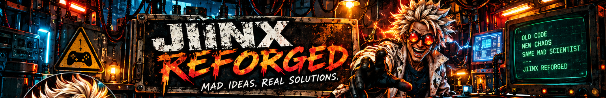

### MAD IDEAS. REAL SOLUTIONS.

**LAB STATUS:** `ONLINE` &nbsp; | &nbsp; **SUPERVISION:** `QUESTIONABLE` &nbsp; | &nbsp; **SANITY:** `OPTIONAL`

---

## WELCOME TO THE LABORATORY

They said it _couldn't_ be done. They said it _shouldn't_ be done.

Naturally, I took that as encouragement.The rest become “research.” At least, that’s what we tell the authorities.

I'm **Jiinx**. I dabble in game emulation, tinkering with software, automation, tools, and whatever questionable idea wandered into the lab overnight.

**Old code. New chaos. Everything gets REFORGED.**

## LAB NOTES

Some projects are experiments. Some become tools. A few probably should have stayed in containment.

The good ones earn their own repositories. The rest become **“research.”** At least, that’s what we tell the authorities.

[THE INSANITARIUM](https://www.jiinx.dev)

_No guarantees. No adult supervision. Results may be spectacular._

